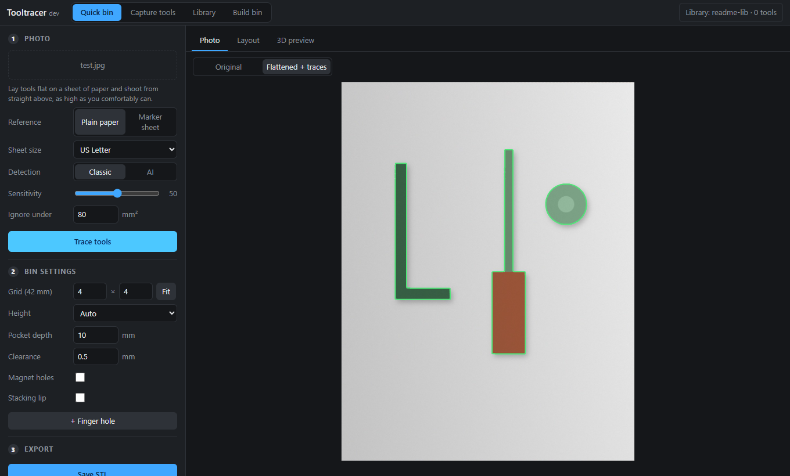
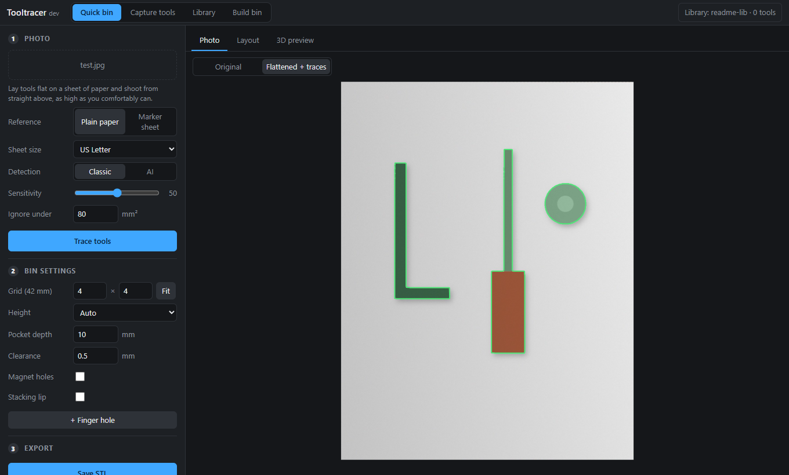
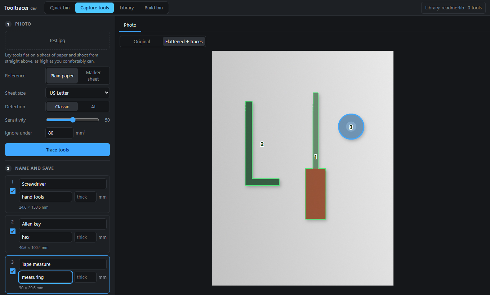
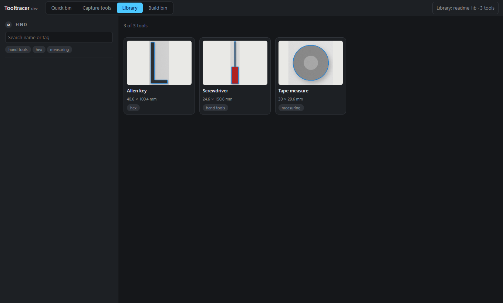
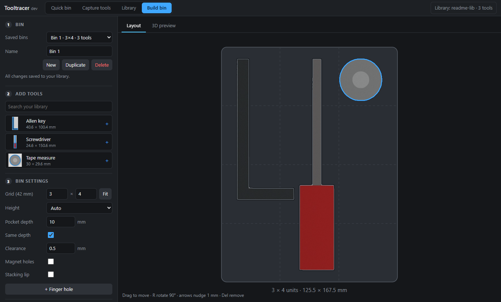
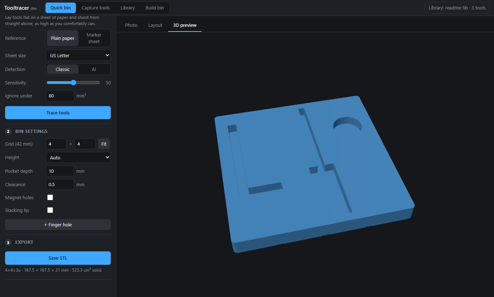
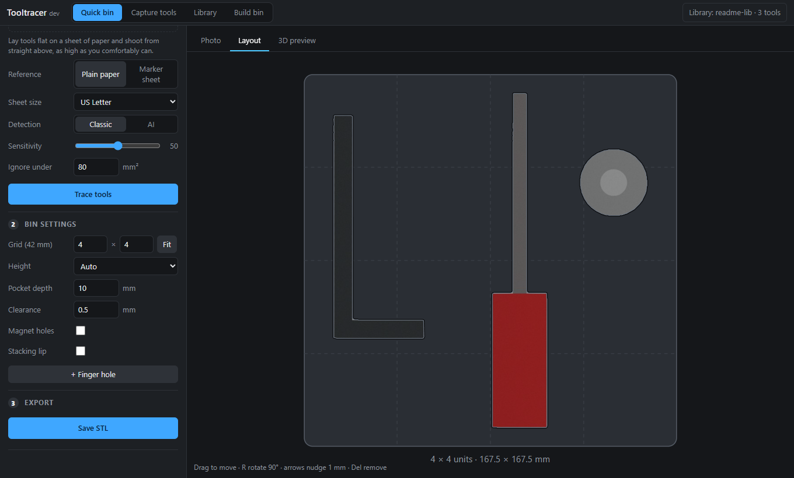

# Tooltracer

**Photograph your tools on a sheet of paper and get a 3D-printable [Gridfinity](https://gridfinity.xyz) bin with
tool-shaped pockets.**

Lay tools on a sheet of paper, take a photo from above, and Tooltracer traces each outline at true size, builds up
a searchable library of your tools, and generates a bin (STL) with a pocket for each one. Everything runs on your
own computer; nothing is uploaded anywhere.



- Works with Windows, macOS and Linux, as a desktop app (or in your browser).
- True-scale outlines from plain paper (Letter, A4, …) or a printable marker sheet.
- Classic (OpenCV) or AI (offline IS-Net) tool detection.
- A reusable tool library: trace once, use a tool in as many bins as you like.
- Standard 42 mm Gridfinity bins: magnet holes, stacking lip, finger holes, per-pocket depth.

> [!NOTE]
> The screenshots in this guide use a synthetic test photo so they are reproducible
> (`scripts/make_test_photo.py`); real photos of real tools work the same way.

**Contents:** [Install](#install) · [Quick start](#quick-start) · [User guide](#user-guide) ·
[Developer guide](#developer-guide) · [Contributing](#contributing) · [License](#license)

---

# For users

## Install

Download the latest build for your system from the **[Releases](../../releases)** page. Every past version stays
listed there.

| System | File | Install / upgrade |
| --- | --- | --- |
| Windows | `Tooltracer-<version>-windows-setup.exe` | Run it. Running a newer one upgrades the installed copy in place. |
| Windows (no install) | `Tooltracer-<version>-windows-portable.zip` | Unzip anywhere and run `Tooltracer.exe`. |
| macOS (Apple Silicon) | `Tooltracer-<version>-macos-arm64.dmg` | Drag Tooltracer to Applications; choose *Replace* to upgrade. |
| Debian / Ubuntu | `tooltracer_<version>_amd64.deb` | `sudo apt install ./tooltracer_<version>_amd64.deb` (also upgrades). |
| Other Linux | `Tooltracer-<version>-linux-x86_64.tar.gz` | Unpack and run `Tooltracer/Tooltracer`. |

**First launch warnings.** The builds are not code-signed, so Windows SmartScreen (*More info → Run anyway*) and
macOS Gatekeeper (right-click the app → *Open*) warn the first time. macOS and Linux builds are tested automatically
but have had far less real-world use than Windows, so please [report problems](../../issues).

**Upgrading never touches your data.** Your tool library lives in a folder you choose and settings live in your user
profile, both outside the program folder.

Prefer to run from source? See [Run from source](#run-from-source).

## Quick start

1. Lay your tools flat on a sheet of paper and photograph them from straight above ([tips](#taking-a-good-photo)).
2. Open Tooltracer, stay on **Quick bin**, and drop the photo onto the window.
3. Pick your paper size and press **Trace tools**.
4. Open **Layout** to arrange the pockets, then press **Save STL** and slice it for your printer.

That's the whole loop. The rest of this guide covers keeping a library of tools and building bins from it.

## User guide

### The four modes

Tooltracer has four modes, selected along the top of the window.

| Mode | Use it to |
| --- | --- |
| **Quick bin** | Go from one photo straight to a bin. Nothing is saved. |
| **Capture tools** | Trace a photo, then name, tag and save each outline to your library. |
| **Library** | Browse, search, rename, re-tag and delete saved tools. |
| **Build bin** | Combine library tools (from any number of photos) into a bin. |

The photo is shared between Quick bin and Capture tools, so you can trace once and do both.

### Taking a good photo

Lay tools flat on a sheet, shoot from straight above and as high as is practical: tall tools lean outward in a
close-up shot and trace oversized.

**Scale reference** (what tells Tooltracer the real size of things):

- **Plain paper** – Letter, A4, Legal, Tabloid, A3 or a custom size. The sheet's corners set scale and perspective,
  so the whole sheet must be visible against a darker surface.
- **Marker sheet** – print the sheet linked in the sidebar at **100 %** and check its 100 mm ruler. More robust than
  corner-finding (works on a light table, tolerates tools overhanging the edge).

**Detection method:**

- **Classic** – OpenCV: anything that differs from blank paper. Fast and accurate with even light; hard shadows get
  traced as part of the tool (lower the sensitivity or soften the light).
- **AI** – IS-Net segmentation via ONNX Runtime on your CPU. The first use downloads a ~170 MB model into `models/`;
  afterwards it works offline. Better with shadows, but can miss small or flat parts.

### Tracing a photo

Drop a photo (JPEG, PNG, HEIC…) on the Photo tab, choose the reference and detection method, and press
**Trace tools**.



After tracing, *Flattened + traces* shows the outlines on the de-skewed sheet. If the paper was found wrong, switch
to *Original*, drag the four corner handles, and trace again. Use **Sensitivity** and **Ignore under** to remove
specks and shadows.

### Saving tools to your library

In **Capture tools**, each traced outline gets a card: give it a **name**, optional **tags** and the tool's
**thickness**, untick any outlines you don't want, and press **Save to library**.



The first time, you'll be asked to choose a **library folder**; change it any time from the button at the top
right. It holds plain files, so it can live in Dropbox, OneDrive or iCloud and be backed up or copied between
machines (see [Library format](#library-format)).

### Browsing the library

**Library** shows every saved tool with its real-world size and tags. Search by name or tag, click a card to rename,
re-tag, set its thickness, add it to a bin or delete it.



### Building a bin

**Build bin** combines tools from your library, from any number of photos, into one bin. Bins are saved
automatically and can be reopened, duplicated and re-exported. If a tool is edited later, bins that use it pick up
the change.



- Click a tool in **Add tools** to place it; **drag** to move, **`R`** rotates 90°, **arrow keys** nudge by 1 mm,
  **`Del`** removes.
- **Grid** sets the bin size in 42 mm units; **Fit** sizes the grid to your tools and centres them.
- **Pocket depth** and **Clearance** (extra room around each outline, default 0.5 mm) set the pocket size.
- Untick **Same depth** and each pocket uses its tool's saved thickness (or the default depth if it has none);
  select a pocket to override it individually.
- **+ Finger hole** adds a round cut-out to make tools easier to lift out.

### Bin options and 3D preview

Bins use the standard 42 mm Gridfinity footprint with the stepped base profile and 7 mm height units (auto-raised to
keep at least 1 mm of floor under the deepest pocket).

- **Magnet holes** – optional 6.5 × 2.4 mm holes in the base.
- **Stacking lip** – a 3.9 mm rim around the top whose inner face mirrors the foot profile, so another Gridfinity bin
  locks on top. The rim is 2.6 mm thick at its base, so pockets are kept that far from the edge (the layout view
  shows the rim), and tools need to sit flush with or below the bin top for a bin to stack on them.

Check the **3D preview**, then press **Save STL**.



### Quick bin

Quick bin is the same layout and bin options, applied directly to the tools in the photo you just traced. Open
**Layout** to arrange them:



### Library format

```
<library>/
  library.json
  tools/<id>/tool.json    name, tags, thickness, outline in mm
  tools/<id>/photo.jpg    flattened photo crop of the tool
  bins/<id>.json          bin settings + which tools sit where
```

Only the folder's location is stored outside it, in the per-user config directory.

### Troubleshooting

| Symptom | Try |
| --- | --- |
| Whole sheet not found | Make sure all four corners are visible against a darker surface, or drag the corner handles in *Original*. |
| Tool traced too big | Shoot from higher up; tall objects lean outward in close-ups. |
| Shadows traced as part of a tool | Lower *Sensitivity*, soften the light, or switch to **AI**. |
| Scale is wrong with a marker sheet | Print at exactly 100 % (no "fit to page") and check the 100 mm ruler. |
| Windows or macOS blocks the app | The builds are unsigned: see [First launch warnings](#install). |
| Something else | [Open an issue](../../issues/new/choose). |

---

# For developers

## Run from source

You need [uv](https://docs.astral.sh/uv/) (it installs Python 3.12 for you).

```bash
uv sync --extra ai
```

```bash
uv run tooltracer
```

This opens a desktop window (Windows, macOS, Linux). Skip `--extra ai` if you only want classic detection.

| Option | Effect |
| --- | --- |
| `--browser` | Use your browser instead of a window (also the automatic fallback if no window backend is available). |
| `--no-browser` | Start the server only (used by `.claude/launch.json`). |
| `--library <folder>` | Use a library folder for this run only. |
| `--config-dir <folder>` | Keep settings elsewhere. |

On Linux the window uses Qt (installed automatically).

To try it without a camera, generate a synthetic photo with known-size tools (add `--markers` for the marker-sheet
variant):

```bash
uv run python scripts/make_test_photo.py out/test.jpg
```

## How it works

```
photo ─► rectify ─► segment ─► outlines (mm) ─► library ─► gridfinity ─► STL
         paper/ArUco  classic/AI    polygons       tool.json     manifold3d
         → 5 px/mm
```

1. **`rectify.py`** finds the paper (or ArUco markers) and perspective-corrects the photo to a flat image at
   5 px per mm, so pixel distances are real distances.
2. **`segment.py`** produces a mask (classic OpenCV differencing against the paper, or IS-Net through ONNX Runtime)
   and smooths it into polygon outlines in millimetres.
3. **`library.py`** stores outlines, photos and bins as plain JSON/JPEG files.
4. **`gridfinity.py`** builds the bin solid with [manifold3d](https://github.com/elalish/manifold) (base profile,
   pockets, magnet holes, lip) and exports STL.
5. **`server.py`** exposes it all as a local FastAPI app that **`static/`** (vanilla JS + vendored three.js)
   talks to, and **`launcher.py`** wraps it in a pywebview window.

## Repository layout

```
tooltracer/
  launcher.py     starts the local server and the desktop window (pywebview) or browser
  server.py       FastAPI app: tracing, library, saved bins, STL
  library.py      the on-disk library and the settings file
  rectify.py      paper / ArUco detection and perspective correction
  segment.py      classic and AI masks → smoothed outlines in mm
  gridfinity.py   bin solid and STL export
  _version.py     "0.0.0+dev" placeholder; the release workflow stamps the real version
  static/         the UI (index.html, app.js, style.css; three.js vendored under vendor/, MIT)
tests/            source tests (pytest)
scripts/          make_test_photo.py – synthetic test photos
packaging/        PyInstaller spec, Windows (Inno Setup) and Linux (.deb) installers, test_packaged.py
.github/          CI, release workflow, CODEOWNERS, repository rulesets
docs/images/      README screenshots
```

The web UI is a single page with no build step: edit `tooltracer/static/` and reload.

## Tests

```bash
uv run --group dev pytest
```

The source tests cover photo → outline accuracy, bin geometry, the library and the HTTP API. A built or installed
app can also be tested from the outside:

```bash
uv run --group dev python packaging/test_packaged.py --exe dist/Tooltracer/Tooltracer.exe --ai --window
```

It uploads a synthetic photo with known tool sizes, traces it (classic and AI), saves tools and a bin to a library,
exports an STL, then opens the real desktop window and checks the UI loaded.

## Building the app

```bash
uv run --group build pyinstaller packaging/tooltracer.spec --noconfirm
```

The result is in `dist/`. The Windows installer is then made with [Inno Setup](https://jrsoftware.org/isinfo.php)
(`iscc /DAppVersion=0.3.0 packaging\windows\tooltracer.iss`), the `.deb` with `packaging/linux/build_deb.sh 0.3.0`.

## Continuous integration and releases

| Workflow | When | What |
| --- | --- | --- |
| `build.yml` | called by the others | Tests the source, builds the app, tests the built app, builds the installer, installs an older version, upgrades it and re-tests, on Windows, macOS and Linux. |
| `ci.yml` – *Build check* | every pull request and new commit pushed to it | Runs `build.yml` and publishes nothing. Logs and a window screenshot are kept for 3 days as `test-output-<os>`. |
| `release.yml` – *Release builds* | manually, or on a `v*.*.*` tag | Runs `build.yml` and, only if all three platforms pass, publishes a GitHub Release with every installer. |

macOS runners are billed at a higher rate on private repositories, so each build check uses a noticeable share of
the free Actions minutes.

**Releases are maintainer-only.** `release.yml` refuses to run unless started by the repository owner on code that
is already on `main`, and it refuses a version that already exists instead of overwriting it. To release:
**Actions → Release builds → Run workflow** on `main`, enter a version such as `0.3.0` (or push a `v0.3.0` tag).
How `main` and tags are protected is described in [`.github/rulesets`](.github/rulesets/README.md).

---

# Contributing

Contributions are welcome: bug reports, photos that trace badly, fixes and features. See
[CONTRIBUTING.md](CONTRIBUTING.md) for the full steps. In short:

1. [Open an issue](../../issues) for anything non-trivial so we can agree on the approach first.
2. Fork the repo and create a branch from `main`.
3. Make your change and add or update tests; run `uv run --group dev pytest`.
4. Open a pull request. The **Build check** must pass, and the maintainer reviews and merges.

By contributing you agree your contribution is licensed under the same terms as the project (see below).

# License

Tooltracer is licensed under the **[PolyForm Noncommercial License 1.0.0](LICENSE)**. In plain terms:

- ✅ **Free for personal use**, including hobby projects, and for printing bins for yourself, friends and family.
- ✅ **You may fork, modify and share** it, as long as you keep the licence and the `Required Notice` line with it.
- ❌ **You may not sell it** or use it commercially: no selling the app or modified versions, and no paid products or
  services built on it.

This is a *source-available* licence rather than an OSI-approved "open source" one, because open-source licences
cannot forbid commercial use. If you want to use Tooltracer commercially, please get in touch via an issue to ask
for separate permission. The legal text in [`LICENSE`](LICENSE) is what counts; this summary is only a guide.

Bundled third-party code (three.js, MIT) keeps its own licence in `tooltracer/static/vendor/LICENSE`.
